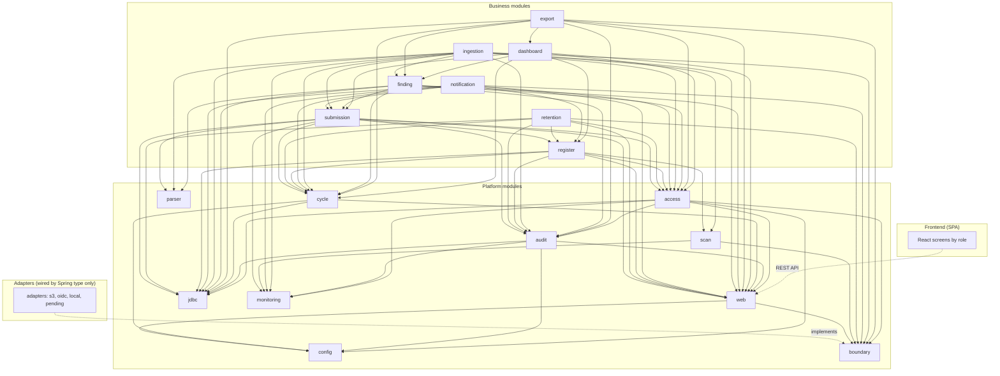
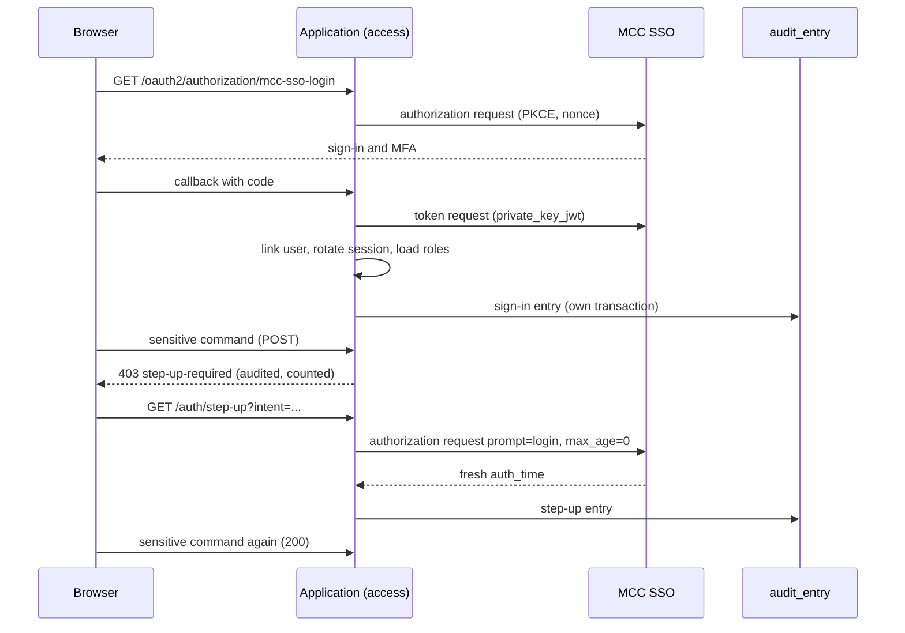
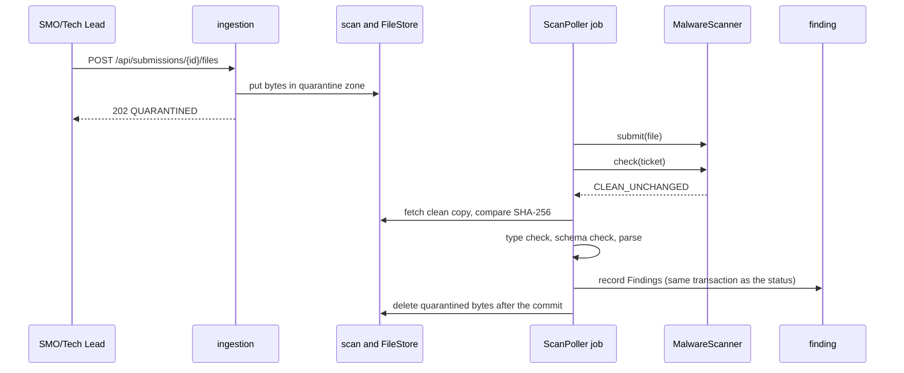
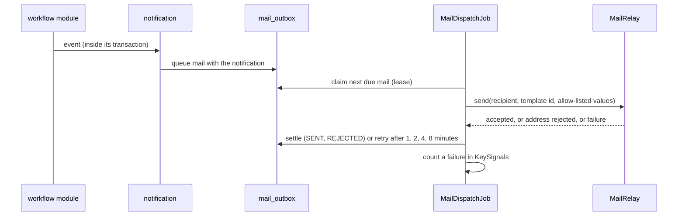

# Technical Architecture Document
> Generated: 2026-11-18T11:03:54Z
> Project: Annual VA (annualVA2): `frontend/` (React) and `backend/` (Spring Boot)
> Produced by `/tech-arch-doc` for ticket 52 (IM8 pm-6). A point-in-time document: `DocumentationCompletenessTest` fails the build when a module, boundary adapter, profile or ADR is added without being named here, so refresh it (re-run `/tech-arch-doc`) in the change that adds one.

## 1. Architecture Narrative

### 1.1 System Overview

Annual VA is the internal application that runs the organisation's annual vulnerability assessment (VA): the VA Cycle and its Quarters, the System Register, VA Submissions with their Scan Reports and Findings, Cyber Manager review, VA POC endorsement, Exemptions, notifications, exports, the audit log and retention. Terms are those of `CONTEXT.md`; the authoritative requirements are the Gate-1-approved spec (`.scratch/annual-va/spec.md`).

- **Back end:** Spring Boot 4.0.8 on Java 21 (the Java 21 baseline is recorded in `docs/agents/reviewer-decisions.md`), a modular monolith of 20 packages under `sg.annualva`, one deployable. PostgreSQL 17 through `JdbcClient` with Flyway migrations (ADR 0001), static SQL in `*Store` classes only (IM8 as-2), UUID primary keys (ADR 0010), timestamps in UTC and business dates in `Asia/Singapore` read only through the `Clock` bean (ADR 0006).
- **Front end:** Vite, React 19 and TypeScript (ADR 0002): a thin shell over the HTTP API. Every business rule is decided in the back end and is tested at the HTTP API (Seam 1, ADR 0009); report content is only ever rendered as text.
- **Platform:** MCC SSO (OIDC, `private_key_jwt`, step-up as a fresh sign-in, ADR 0004), a malware scanner (SFS), a mail relay (MCNS), an S3 object store with SSE-KMS, the MCC service client. Each is reached through a port in `boundary` (section 1.7). Locally the stack is `../mock-m-sso` plus LocalStack and PostgreSQL (ADR 0003), or PostgreSQL alone under `dev-local` (ADR 0058).
- **Security posture:** deny by default with method-level `@PreAuthorize` and a per-System ownership guard (ADR 0013), roles read from the database on each request and never from token claims (ADR 0011), JDBC sessions with idle and absolute limits (ADR 0008), a minimal CSP and HSTS, an append-only audit log that also records every refusal (ADR 0014), and no report content in logs, audit entries, errors or metrics.

### 1.2 Module Summary

| Module | Source files | Description |
|---|---|---|
| `access` | 64 | Sign-in through MCC SSO, users, sessions, the role store, step-up and the per-System ownership check. |
| `adapters` | 21 | The production and local implementations of the boundary ports (identity provider, malware scanner, mail relay, file store, account status). |
| `app` | 5 | The composition root: the Spring Boot entry point, the clock bean, the security filter chains (the application and the metrics scrape). |
| `audit` | 15 | The append-only audit log: writing entries in the action's transaction or on their own, the ECS event after the commit, and the read scope port. |
| `boundary` | 7 | The ports at the edge of the application: identity provider, account status, malware scanner, mail relay, file store. The only things Seam 1 tests fake (with the clock). |
| `config` | 3 | Shared configuration: application properties and the dev-local and not-dev-local profile markers. |
| `cycle` | 10 | The VA Cycle and Quarter calendar, computed from the year, two settings and the clock; the stored record of a Cycle opening and closing. |
| `dashboard` | 16 | Read models for the roles: the SMO inbox, the Cyber Manager inbox, the Quarter board and the VA POC Cycle matrix. |
| `export` | 17 | Exports made in the background and kept 24 hours in the export zone: the management summary in Excel and PDF. |
| `finding` | 43 | Findings read from Scan Reports, their status proposals, the Cyber Manager review, the rework queue and the manual Findings. |
| `ingestion` | 21 | The Scan Report upload pipeline: quarantine, scan job, type and schema checks, parsing, and the file views. |
| `jdbc` | 2 | What every store shares about PostgreSQL through JdbcClient: how an instant is written and read. |
| `monitoring` | 2 | The key signals (meters) an operator watches, named and registered in one place (ADR 0060). |
| `notification` | 19 | In-app notifications, the mail outbox and its dispatcher, deadline reminders. |
| `parser` | 24 | Reading Scan Report files: the hardened XML reader and one parser per vendor format (Dependency-Check, SCAP, Nessus, Burp Suite). |
| `register` | 31 | The System Register: the Excel template, upload and preview, the locked apply, the Systems list, SMO Unreachable, the role-holder review. |
| `retention` | 11 | Retention and disposal: the disposal list a VA POC approves and the executor that deletes files and records. |
| `scan` | 4 | Quarantine and malware scan shared by the Scan Report pipeline and the Register upload. |
| `submission` | 34 | The VA Submission state machine, submit, review steps, endorsement, Exemptions, the Overdue sweep, the Cycle lifecycle and role lapses. |
| `web` | 10 | Cross-cutting HTTP: RFC 9457 problems, the correlation id, the refusal listener, CSRF and session bootstrap. |
| `frontend` | see section 1.8 | The React single-page application. |

### 1.3 Module Interaction Diagram

Arrows run from the module that uses to the module used, as `ArchitectureTest.modulesDependOnlyDownwards` allows them (the `app` composition root may use every module and nothing uses it, so its arrows are left out). The tests enforce that the modules are free of cycles and that the platform modules (`web`, `config`, `jdbc`, `boundary`, `monitoring`, `audit`, `access`, `cycle`, `scan`, `parser`) depend on no business module.

### 1.4 Module Interactions

- **Sign-in and roles (`access`).** The browser is sent to MCC SSO through the OIDC authorization-code flow; the callback links the sign-in to a user (by `sso_id`, else pre-registered email, else new), rotates the session and audits it. Roles live in `role_grant` and are read into a `RoleAuthentication` on every request. `AccessGuard` is the one ownership check every service path that addresses a System calls. `StepUp.require(intent)` makes a sensitive command need a sign-in within five minutes.
- **Register and submissions.** A VA POC uploads the System Register workbook; `register` scans it synchronously through `scan`, reads it into a preview, and applies a confirmed preview in one locked transaction that also grants the SMO/Tech Lead and Cyber Manager roles through `access` and withdraws in-flight work through the `InFlightWork` port the `submission` module implements. An SMO/Tech Lead starts a VA Submission (`submission`), uploads Scan Reports (`ingestion`), proposes Finding statuses (`finding`), submits; a Cyber Manager reviews and passes or returns it; a VA POC endorses with a fresh sign-in.
- **Files.** `ingestion` puts every upload in the quarantine zone of the file store through `scan`, the scan job asks the scanner for a verdict, and only the scanner's unchanged copy is type-checked, schema-checked and parsed (`parser`) into Findings (`finding`). Nobody can view a file until it is clean (ADR 0021).
- **Time-driven work.** `@Scheduled` jobs (only where `annualva.scheduling.enabled`; Seam 1 runs each by hand) sweep Overdue (`submission`), open and close Cycles, lapse Exemptions and roles, plan deadline reminders and dispatch the mail outbox (`notification`), make exports (`export`) and propose disposal lists (`retention`). A scheduler lock without ShedLock keeps instances from doubling the work (ADR 0012).
- **Notifications and mail.** Workflow modules publish events inside their transaction; `notification` writes the in-app notice and queues the mail after the commit, and `MailOutbox` hands it to the mail relay with allow-listed values only (ADR 0043, 0046).
- **Audit.** Modules that act call `AuditLog.record` in their own transaction (`recordIndependently` for refusals and sign-ins); the entry is also emitted as an ECS event on the `annualva.audit` logger after the commit. The audit read scope is a port (`AuditReaders`) the `submission` module answers (ADR 0038).
- **Monitoring.** `monitoring.KeySignals` is injected by the modules that have a signal to record; the endpoint `/actuator/prometheus` is served behind its own security chain (section 1.9, ADR 0060).

### 1.5 Execution Flow

**Request lifecycle.** `CorrelationIdFilter` assigns or accepts a correlation id; the security chain (the application's, or the scrape chain for `/actuator/prometheus`) authenticates and applies CSRF (synchronizer token), the CSP and HSTS headers; `RoleResolutionFilter` loads the caller's grants; the controller's `@PreAuthorize` rule and `AccessGuard` decide; a service runs the command in one transaction that includes its audit entry; `ApiExceptionHandler` turns any failure into an RFC 9457 problem with the correlation id and reports each 401 or 403 to the refusal listener, which audits it.

**Background processes.** Scan job (10 s), Overdue sweep (hourly and at start), mail dispatch (30 s), deadline reminders (daily), Cycle lifecycle, Exemption lapse, role lapse, exports and retention. Each is a plain bean a Seam 1 test calls through a test-only endpoint.

**Initialisation.** Flyway applies `db/migration` (V1 to V43, gapless: `MigrationSequenceTest`); the two VA POCs are synced from `annualva.va-pocs`; configuration is validated at start and a missing secret stops the application (ADR 0005).

### 1.6 Execution Flow Diagrams

Sign-in and step-up (ADR 0004):

Scan Report upload (ADR 0021):

Required mail (ADR 0043, 0046):

### 1.7 Boundary Ports and Adapters

Seam 1 tests fake only these (and the clock); everything else is real, including PostgreSQL (Testcontainers). Production implementations live only under `sg.annualva.adapters` and no module imports them (`ArchitectureTest`). The AWS SDK is used only by the S3 adapter.

| Port (`boundary`) | Adapter | Package | Where it is active | Seam 1 fake |
|---|---|---|---|---|
| `FileStore` | `S3FileStore` (S3 with SSE-KMS, ADR 0059) | `adapters.s3` | where `annualva.aws.enabled=true` and not `dev-local` (`dev-mcc`; a deployment by property) | `InMemoryFileStore` |
| `FileStore` | `LocalFileStore` | `adapters.local` | `dev-local` | |
| `FileStore` | `UnwiredFileStore` (fail-closed stand-in) | `adapters.pending` | where `annualva.aws.enabled` is off, not `dev-local` | |
| `MalwareScanner` | `LocalMalwareScanner` | `adapters.local` | `dev-local` | `FakeMalwareScanner` |
| `MalwareScanner` | `UnwiredMalwareScanner` (fail-closed) | `adapters.pending` | not `dev-local`, until ticket 51's scanner adapter | |
| `MailRelay` | `LocalMailRelay` | `adapters.local` | `dev-local` | `CapturingMailRelay` |
| `MailRelay` | `UnwiredMailRelay` (fail-closed) | `adapters.pending` | not `dev-local`, until ticket 51's mail adapter | |
| `IdentityStatus` | `LocalIdentityStatus` | `adapters.local` | `dev-local` | `FakeIdentityStatus` |
| `IdentityStatus` | `UnwiredIdentityStatus` (fail-closed) | `adapters.pending` | not `dev-local`, until ticket 51's service-client adapter | |
| `IdentityProvider` | `MccIdentityProvider` (MCC SSO: explicit endpoints, `private_key_jwt`, EC P-521; with `MccClientConfig`, `MccHttp`, `SigningKeys`, `JwksController`) | `adapters.oidc` | every profile but `dev-local` | `FakeOidcIssuer` (an in-process issuer) |
| `Clock` | `ClockConfig` (`app`) | `app` | always | `MutableClock` |

Configuration of the adapters: `LocalAdapterProperties` (`adapters.local`), `MccSsoProperties` (`adapters.oidc`), `AwsProperties` (`adapters.s3`). The scanner, mail and service-client production adapters wait for `mock-m-sso` (ticket 51 is open beyond the file store).

### 1.8 Front end

`frontend/src`: `app` (shell, router, step-up interstitial, sign-in screens for `dev-local`), `api` (a typed client per back-end area: `session`, `systemRegister`, `submissions`, `scanReports`, `reportFiles`, `findings`, `dashboards`, `exemptions`, `exports`, `disposal`, `roleHolders`, `audit`, `notifications`, `cycles`, `stepUp`, `dev`), `components` (`ClassificationBanner`, `ClassifiedField`, `ErrorPanel`, `FilterChips`, `ProgressBar`), `hooks`, and `screens` by role (`smo`, `cyber-manager`, `va-poc`, `auditor`, `shared`). Gates: Prettier, `tsc -b`, `vite build`, a no-raw-HTML check, dependency-cruiser and fallow. There are no React unit tests (ADR 0009).

### 1.9 Profiles and Monitoring

| Profile | File | Use |
|---|---|---|
| (base) | `application.yml` | the production shape: bare `${ENV_VAR}` for every environment value (ADR 0005) |
| `dev-mcc` | `application-dev-mcc.yml` | local development against `../mock-m-sso`, LocalStack and compose PostgreSQL; mock values only (ADR 0003) |
| `dev-local` | `application-dev-local.yml` | one machine with PostgreSQL only: a persona picker and local fakes; loopback only and refuses to start with another profile (ADR 0058) |
| `ci` | `application-ci.yml` (test classpath) | Seam 1: Testcontainers PostgreSQL, in-process fakes, plain HTTP |
| `sit` | `application-sit.yml` | the first deployed target: `${VAR:default}` for what is not secret; secrets have no default (ADR 0005) |

UAT and production run the base configuration with every value supplied by the environment. The README's "Profiles, secrets and environments" section lists the variables.

Monitoring (IM8 lm-16, ADR 0060): `monitoring.KeySignals` registers the Overdue gauges and the counters for scan failures and timeouts, mail failures, step-up refusals and audit write failures. `/actuator/prometheus` has its own security chain with a bearer token (`app.MetricsScrapeSecurity`); `/actuator/health` is anonymous and liveness-only. The README's run book gives each signal's alert threshold and the operator response.

## 2. Software Module Catalog

Each module lists its purpose, what it depends on (from its `package-info.java` and the layering test), the HTTP endpoints its controllers serve, and its public types. Method-level detail is in the Javadoc of each class.

#### `access`
- **Source files:** 64 under `backend/src/main/java/sg/annualva/access/`
- **Purpose:** Sign-in through MCC SSO, users, sessions, the role store, step-up and the per-System ownership check.
- **Dependencies:** audit, boundary, config, monitoring and web only
- **Used by:** dashboard, export, finding, ingestion, notification, register, retention, submission, app

**Endpoints:**

| Method | Path |
|---|---|
| GET | `/api/dev/personas` |
| POST | `/api/dev/step-up` |
| GET | `/api/session` |
| GET | `<StepUpRequiredException.START_PATH>` |

| Type | Kind | Description |
|---|---|---|
| `AccessGuard` | class |  |
| `AppUser` | record | A person known to the application: pre-registered by email (System Register) or linked to an identity-provider id at first sign-in. |
| `AppUserStore` | class |  |
| `AuditActor` | class |  |
| `CurrentUser` | class |  |
| `DevIdentityProperties` | record |  |
| `DevLocalController` | class |  |
| `GrantSource` | enum | Where a role grant came from: the only three ways a role is ever given. |
| `Need` | enum | What a caller wants to do with a System, named after the steps of the VA Submission flow. |
| `RegisterRoles` | class |  |
| `ReturnTrigger` | enum | Why a lapsed grant came back by itself (story 80a, IM8 ac-3, ADR 0055). |
| `Role` | enum | The four roles, in the order a person's first role is chosen: the highest privilege first. |
| `RoleAuthentication` | class | The caller as one request sees them: the session's SessionUser plus the role grants that count right now, read from the role store at the start of the request (ADR 0011). |
| `RoleGrant` | record | One row of the role store: a person (by email, and by user once they have signed in) holds a role, for one System where the role is per System. |
| `RoleGrantStore` | class |  |
| `RoleHolder` | record | One grant that has not been revoked, as the role-holder review lists it (ticket 47, IM8 ac-4): the grant, and what the person's user record says. |
| `RoleHolderChanged` | record | A VA POC gave a System someone who can act at a step again (decided 2026-10-26): they restored its SMO/Tech Lead's or Cyber Manager's suspended role, or applied a Register that revoked the role or brought a lapsed one back. |
| `RoleHolders` | class |  |
| `RoleLapse` | class |  |
| `SessionAuthentication` | class | The authentication stored in the session after a successful sign-in. |
| `SessionController` | class |  |
| `SessionUser` | record | The signed-in person as kept in the server-side session: the user id (the only identifier that may appear in logs), what the header shows, and the two instants the session rules need. |
| `SignInProperties` | record |  |
| `SignInRefusedException` | class | A sign-in the application refuses after the identity provider accepted it: no session is created. |
| `SignInSecurity` | class |  |
| `SignInService` | class |  |
| `StepUp` | class |  |
| `StepUpController` | class |  |
| `StepUpProperties` | record |  |
| `SuspensionCause` | enum | Why a grant is suspended (ticket 47, ADR 0056). |
| `SystemScope` | record | Which Systems a caller may reach for one Need: every System (a VA POC), or exactly the listed ones. |
| `VaPocProperties` | record |  |

#### `adapters`
- **Source files:** 21 under `backend/src/main/java/sg/annualva/adapters/`
- **Purpose:** The production and local implementations of the boundary ports (identity provider, malware scanner, mail relay, file store, account status).
- **Dependencies:** see section 1.3

**Endpoints:**

| Method | Path |
|---|---|
| GET | `/.well-known/jwks.json` |

| Type | Kind | Description |
|---|---|---|
| `LocalAdapterProperties` | record |  |
| `JwksController` | class |  |
| `MccSsoProperties` | record |  |
| `AwsProperties` | record |  |

#### `app`
- **Source files:** 5 under `backend/src/main/java/sg/annualva/app/`
- **Purpose:** The composition root: the Spring Boot entry point, the clock bean, the security filter chains (the application and the metrics scrape).
- **Dependencies:** see section 1.3

| Type | Kind | Description |
|---|---|---|
| `AnnualVaApplication` | class |  |
| `MonitoringProperties` | record |  |

#### `audit`
- **Source files:** 15 under `backend/src/main/java/sg/annualva/audit/`
- **Purpose:** The append-only audit log: writing entries in the action's transaction or on their own, the ECS event after the commit, and the read scope port.
- **Dependencies:** config, web and monitoring only
- **Used by:** access, export, finding, ingestion, register, retention, submission, app

**Endpoints:**

| Method | Path |
|---|---|
| GET | `/api/audit-entries` |

| Type | Kind | Description |
|---|---|---|
| `AuditAction` | enum | What an audit entry records. |
| `AuditCaller` | interface | Names the caller of the current request on an entry the audit module writes about its own reads (ticket 50): the access module answers, because it knows who is signed in and the roles they hold, so the audit log depends on none of the modules that write to it. |
| `AuditController` | class |  |
| `AuditDetail` | class | The allow-listed detail of an audit entry: keys from DetailKey only, values that are a short code (letters, digits and . |
| `AuditEntry` | record | One stored audit entry as the audit log API returns it. |
| `AuditEvent` | record | One thing to be recorded. |
| `AuditFilter` | record | What the audit log is narrowed by; a null field does not narrow. |
| `AuditLog` | class |  |
| `AuditOutcome` | enum | How an audited action ended. |
| `AuditQuery` | record | One read of the audit log as a reader asked for it: the filters (a null one does not narrow), with from and to as business dates, both inclusive, and the page. |
| `AuditReadScope` | record | Which entries a caller may read (the permissions matrix, story 85): every entry (a VA POC), or exactly the entries about these VA Submissions (a Cyber Manager: those they reviewed on Systems still assigned to them). |
| `AuditReaders` | interface | Who may read which entries, answered by the module that knows who reviewed what (the VA Submissions), so the audit log depends on none of the modules that write to it (ADR 0038). |
| `DetailKey` | enum | The only keys an audit entry's detail may carry. |

#### `boundary`
- **Source files:** 7 under `backend/src/main/java/sg/annualva/boundary/`
- **Purpose:** The ports at the edge of the application: identity provider, account status, malware scanner, mail relay, file store. The only things Seam 1 tests fake (with the clock).
- **Dependencies:** see section 1.3
- **Used by:** access, adapters, export, ingestion, notification, retention, scan, web, app

| Type | Kind | Description |
|---|---|---|
| `BoundaryFailureException` | class | A boundary adapter could not do what it was asked: the object store or the scanner was unreachable, refused the call or answered something unusable. |
| `FileStore` | interface | The file-store port: the encrypted object store that holds uploaded files and the exports the application makes. |
| `IdentityProvider` | interface | The identity-provider port: turns the verified token claims of a sign-in into the identity the access module links to a user. |
| `IdentityStatus` | interface | The identity provider's account status (IM8 ac-3, ticket 47, ADR 0056): whether the provider has disabled a person since they signed in. |
| `MailRelay` | interface | The mail-relay port: the organisation's notification service, which sends an email from an onboarded template (ADR 0003, assumption A-9). |
| `MalwareScanner` | interface | The malware-scanner port (IM8 as-12, spec story 24): a file in the quarantine zone is submitted, the verdict is checked until it is final, and the unchanged copy is fetched. |

#### `config`
- **Source files:** 3 under `backend/src/main/java/sg/annualva/config/`
- **Purpose:** Shared configuration: application properties and the dev-local and not-dev-local profile markers.
- **Dependencies:** see section 1.3
- **Used by:** access, adapters, audit, cycle, web, app

| Type | Kind | Description |
|---|---|---|
| `AnnualVaProperties` | record |  |

#### `cycle`
- **Source files:** 10 under `backend/src/main/java/sg/annualva/cycle/`
- **Purpose:** The VA Cycle and Quarter calendar, computed from the year, two settings and the clock; the stored record of a Cycle opening and closing.
- **Dependencies:** config and web only
- **Used by:** dashboard, export, finding, ingestion, notification, register, retention, submission, app

**Endpoints:**

| Method | Path |
|---|---|
| GET | `/api/cycles` |
| GET | `/api/cycles/{year}` |

| Type | Kind | Description |
|---|---|---|
| `CalendarProperties` | record |  |
| `CycleCalendar` | class |  |
| `CycleController` | class |  |
| `CyclePhase` | enum | Where a VA Cycle stands on a business day. |
| `CycleStore` | class |  |
| `CycleView` | record | What GET /api/cycles/{year} answers, and each item of GET /api/cycles: the Cycle, its Quarters and their windows, and where today falls in it. |
| `Quarter` | record | One Quarter of a VA Cycle: it starts on a Monday and runs to the day before the next Quarter starts (12 to 14 weeks). |
| `VaCycle` | record | One VA Cycle, named after the year it starts. |
| `Window` | enum | The three windows of a Quarter; they are soft, nothing locks when one is missed. |

#### `dashboard`
- **Source files:** 16 under `backend/src/main/java/sg/annualva/dashboard/`
- **Purpose:** Read models for the roles: the SMO inbox, the Cyber Manager inbox, the Quarter board and the VA POC Cycle matrix.
- **Dependencies:** access, cycle, register, submission, finding and web only
- **Used by:** export, app

**Endpoints:**

| Method | Path |
|---|---|
| GET | `/api/dashboards/cm-inbox` |
| GET | `/api/dashboards/cycle-matrix` |
| GET | `/api/dashboards/exemption-queue` |
| GET | `/api/dashboards/quarter-board` |
| GET | `/api/dashboards/smo-inbox` |

| Type | Kind | Description |
|---|---|---|
| `CmInbox` | class |  |
| `CmInboxController` | class |  |
| `CycleMatrix` | class |  |
| `CycleMatrixController` | class |  |
| `ExemptionQueue` | class |  |
| `ExemptionQueueController` | class |  |
| `HandledOutside` | record | A System whose Quarter the manual process still runs, as every dashboard lists it apart: named, with no state, dates or action. |
| `InboxGroup` | enum | The heading an inbox lists a System under; which one is the server's answer for each role (ADR 0019 item 2). |
| `QuarterBoard` | class |  |
| `QuarterBoardController` | class |  |
| `SmoInbox` | class |  |
| `SmoInboxController` | class |  |
| `SystemState` | enum | How a System in a Quarter is shown on a dashboard: Not Started while it has no VA Submission, otherwise its VA Submission's state (Not Started too for one a rejected Exemption request created). |

#### `export`
- **Source files:** 17 under `backend/src/main/java/sg/annualva/export/`
- **Purpose:** Exports made in the background and kept 24 hours in the export zone: the management summary in Excel and PDF.
- **Dependencies:** access, audit, boundary, cycle, dashboard, finding and web only

**Endpoints:**

| Method | Path |
|---|---|
| POST | `/api/exports` |
| GET | `/api/exports` |
| GET | `/api/exports/{id}` |
| GET | `/api/exports/{id}/download` |

| Type | Kind | Description |
|---|---|---|
| `Classification` | enum | The classification an export carries in its header, footer and first row (story 86, assumption A-1): Confidential when it covers the complete set (every System of the Quarter or the Cycle it is about), otherwise Restricted / Sensitive-Normal. |
| `ExportController` | class |  |
| `ExportFormat` | enum | The file an export is made as: an Excel workbook (ticket 44) or a PDF (ticket 45) of the same content. |
| `ExportStatus` | enum | Where an export is: waiting for the export job, made and downloadable, failed, or past its 24 hours. |
| `ExportType` | enum | What an export is. |
| `ExportWorker` | class |  |
| `Exports` | class |  |

#### `finding`
- **Source files:** 43 under `backend/src/main/java/sg/annualva/finding/`
- **Purpose:** Findings read from Scan Reports, their status proposals, the Cyber Manager review, the rework queue and the manual Findings.
- **Dependencies:** parser, submission, cycle, access, audit and web
- **Used by:** dashboard, export, ingestion, app

**Endpoints:**

| Method | Path |
|---|---|
| POST | `/api/findings/{id}/reviews` |
| POST | `/api/batches/{id}/reviews` |
| GET | `/api/submissions/{id}/findings` |
| GET | `/api/submissions/{id}/readiness` |
| POST | `/api/findings/{id}/proposals` |
| POST | `/api/submissions/{id}/findings/bulk-proposals` |
| POST | `/api/submissions/{id}/findings/manual` |
| GET | `/api/submissions/{id}/batches` |
| GET | `/api/submissions/{id}/rework-queue` |
| GET | `/api/findings/{id}/proposals` |
| POST | `/api/submissions/{id}/reports/{type}/review` |
| GET | `/api/submissions/{id}/reports` |
| PUT | `/api/submissions/{id}/reports/{type}/mode` |

| Type | Kind | Description |
|---|---|---|
| `BatchReviewView` | record | One review of a Bulk-set batch by a Cyber Manager (story 51): the decision and comment every member it decided now carries in its own review, and the members it left out because they changed since the batch. |
| `BatchSummary` | record | A Bulk-set batch as the review screen lists it (story 51): what was proposed, by whom and when, and where its members stand now. |
| `BatchView` | record | A Bulk-set batch as its step answers it (story 37). |
| `BulkProposalRequest` | record | The body of a Bulk-set (story 37): the Findings to apply it to, then one status and its fields exactly as for one Finding (ProposalRequest). |
| `BulkProposals` | class |  |
| `FindingController` | class |  |
| `FindingFilter` | record | What a Findings list is narrowed to; every part is optional and the parts that are given all apply. |
| `FindingSource` | enum | Where a Finding came from (story 23). |
| `FindingStatus` | enum | The disposition the SMO/Tech Lead proposes for a Finding (CONTEXT.md, "Finding Status"). |
| `FindingView` | record | A Finding as the list reads it (story 28). |
| `Findings` | class |  |
| `ManualFindingRequest` | record | The body of a Finding entered by hand (story 23), every field as text so that a field that cannot be read is named in the answer rather than failing the whole body. |
| `ManualFindings` | class |  |
| `ProposalRequest` | record | The body of a proposal, every field as text so that a field that cannot be read is named in the answer rather than failing the whole body. |
| `ProposalView` | record | One proposal of a Finding Status, as the list and the history read it (stories 28 and 35). |
| `ProposedAs` | enum | Who made a Finding Status proposal. |
| `Readiness` | record | How far a VA Submission is (stories 26, 38 and 40): what the progress bar shows, the report files whose age stands in the way of submitting, and every reason it cannot be submitted yet. |
| `ReportFileReadiness` | interface | Where a VA Submission's files stand for submitting (stories 23, 26 and 40), judged where the files are kept: the Scan Report upload pipeline implements it, so the readiness check reads it without this module reaching up into that one. |
| `ReportMode` | enum | How a Scan Report of a VA Submission is provided (story 23, ADR 0030). |
| `ReportModeRequest` | record | The body of a mode change, every field as text so that a field that cannot be read is named in the answer. |
| `ReportType` | enum | The three Scan Reports every VA Submission holds (CONTEXT.md); Secure Configuration is always required. |
| `ReviewCounts` | record | How far the Cyber Manager's review of a VA Submission's Findings is, for a dashboard (story 48). |
| `ReviewDecision` | enum | What a Cyber Manager decides about a proposal or a not-applicable justification (story 50). |
| `ReviewRequest` | record | The body of a review, every field as text so that a field that cannot be read is named in the answer. |
| `ReviewState` | enum | Where the Cyber Manager's review of a Finding's current proposal is. |
| `ReviewView` | record | One review by a Cyber Manager (story 50). |
| `Reviews` | class |  |
| `ReworkQueue` | record | One page of the rework queue of a VA Submission (story 60): the Findings its SMO/Tech Lead still has to act on, stage by stage, and how many each stage holds. |
| `ReworkQueues` | class |  |
| `ReworkStage` | enum | The stages of the rework queue (story 60), in the order the SMO/Tech Lead works through them. |
| `ScanReportController` | class |  |
| `ScanReportView` | record | How one Scan Report of a VA Submission is provided, as anyone who may see the System reads it (story 23). |
| `ScanReports` | class |  |

#### `ingestion`
- **Source files:** 21 under `backend/src/main/java/sg/annualva/ingestion/`
- **Purpose:** The Scan Report upload pipeline: quarantine, scan job, type and schema checks, parsing, and the file views.
- **Dependencies:** submission, scan, parser, access, audit, monitoring and web

**Endpoints:**

| Method | Path |
|---|---|
| POST | `/api/submissions/{id}/files` |
| POST | `/api/submissions/{id}/files/{fileId}/replace` |
| GET | `/api/submissions/{id}/files` |
| GET | `/api/submissions/{id}/files/{fileId}` |
| GET | `/api/submissions/{id}/files/{fileId}/metadata` |
| PUT | `/api/submissions/{id}/files/{fileId}/metadata` |
| GET | `/api/submissions/{id}/files/{fileId}/content` |

| Type | Kind | Description |
|---|---|---|
| `FileKind` | enum | What a file is for. |
| `PipelineStatus` | enum | Where a Scan Report file is in the upload pipeline. |
| `RejectCode` | enum | Why the pipeline rejected a file. |
| `ReportFileController` | class |  |
| `ReportFileMetadataRequest` | record | The scan date and target an SMO/Tech Lead confirms or corrects for a parsed report file (story 25). |
| `ReportFileMetadataView` | record | What a parsed Scan Report file says about the scan, offered to the SMO/Tech Lead to confirm or correct (story 25), and what they confirmed. |
| `ReportFileView` | record | A Scan Report file as the API reports it: where it is in the pipeline and, when it was rejected, why. |
| `ReportFiles` | class |  |
| `ScanPoller` | class |  |

#### `jdbc`
- **Source files:** 2 under `backend/src/main/java/sg/annualva/jdbc/`
- **Purpose:** What every store shares about PostgreSQL through JdbcClient: how an instant is written and read.
- **Dependencies:** see section 1.3
- **Used by:** access, audit, cycle, export, finding, ingestion, notification, register, retention, submission, app

| Type | Kind | Description |
|---|---|---|
| `Timestamps` | class | How every store hands an instant to PostgreSQL and reads one back: a timestamptz is written as the instant at offset UTC, as every timestamp is stored (AGENTS.md), and read back as the instant it names. |

#### `monitoring`
- **Source files:** 2 under `backend/src/main/java/sg/annualva/monitoring/`
- **Purpose:** The key signals (meters) an operator watches, named and registered in one place (ADR 0060).
- **Dependencies:** no other module, so any module may record a signal
- **Used by:** access, audit, ingestion, notification, scan, submission, app

| Type | Kind | Description |
|---|---|---|
| `KeySignals` | class |  |

#### `notification`
- **Source files:** 19 under `backend/src/main/java/sg/annualva/notification/`
- **Purpose:** In-app notifications, the mail outbox and its dispatcher, deadline reminders.
- **Dependencies:** access, boundary, cycle, monitoring, register, submission and web only

**Endpoints:**

| Method | Path |
|---|---|
| GET | `/api/notifications` |
| POST | `/api/notifications/{id}/read` |

| Type | Kind | Description |
|---|---|---|
| `Awaits` | enum | The VA POC decision that handles an item both VA POCs received (story 69): when either makes it, the item clears for both, marked with who handled it. |
| `DeadlineReminders` | class |  |
| `Links` | class | The app paths a notification links to, the same paths the React app routes (its paths.ts per role): fixed segments and ids only, so a link carries nothing a person typed. |
| `MailOutbox` | class |  |
| `MailProperties` | record |  |
| `Notice` | record | What a notification says, before it is addressed: the System, the state, the action, the due date and a link, and nothing else (story 91). |
| `NoticeAction` | enum | What a notification asks its reader to do, or tells them, as a fixed code with the app's own sentence (story 91: only the System, the state, the action, the due date and a link; never a Finding). |
| `NotificationController` | class |  |
| `NotificationView` | record | A notification as its reader lists it: the System, the state, the action, the due date and a link (story 91), when it came and was read, and for an item both VA POCs received, who handled it (story 69). |
| `Notifications` | class |  |

#### `parser`
- **Source files:** 24 under `backend/src/main/java/sg/annualva/parser/`
- **Purpose:** Reading Scan Report files: the hardened XML reader and one parser per vendor format (Dependency-Check, SCAP, Nessus, Burp Suite).
- **Dependencies:** nothing
- **Used by:** finding, ingestion, submission, app

| Type | Kind | Description |
|---|---|---|
| `Confidence` | enum | How sure a scanner says it is that an issue is real, from the most to the least sure: Burp Suite's Certain, Firm and Tentative. |
| `FindingKeys` | class | The identity key of a Finding for each tool, written in one place: the prefix that tells the tools apart and the parts the key is made of (the implementation plan, section 2.4). |
| `FindingsBuilder` | class | What every parser does with the Findings it reads, so that no vendor format repeats it: it merges what has the same identity key into one Finding with one occurrence per distinct place, merges a place read twice (ParsedReport.Occurrence#merge) and takes the wo |
| `ParsedReport` | record | What a parser read out of one Scan Report file: the metadata the SMO/Tech Lead confirms and the Findings, already merged so that each identity key appears once per file. |
| `ReportDates` | class | Reads the date a report says its scan was made. |
| `ReportParser` | interface | One parser per vendor format behind one interface: the bytes of a file that already passed the malware scan, the type allowlist and the schema check go in, the Findings and the metadata come out. |
| `ReportText` | class | Cleans text before it is kept: the one rule for every text that comes from a person or a report and is later shown to someone else. |
| `ScanFacts` | class | What a report says about the scan itself, gathered as a parser reads it so that no format repeats it: the latest date any of its results was made and the hosts it names. |
| `ScanReading` | class | What the parser of a scan report holds while it reads one file, so that no format declares it again: the Findings so far, what the file says about the scan itself, and whether the file had any section of the shape its format has (a Report of a Nessus audit, a  |
| `Severity` | enum | The five-level severity scale every Finding uses (the implementation plan, section 2.4), from the most to the least serious. |
| `UnparseableReportException` | class | The file cannot be read into Findings. |
| `BurpXmlParser` | class | Reads a Burp Suite XML issue export: an issues root that holds one issue per finding of the scan. |
| `DependencyCheckJsonParser` | class | Reads an OWASP Dependency-Check JSON report: an object with reportSchema, scanInfo, projectInfo (the project's name and the report date) and a dependencies array. |
| `DependencyCheckXmlParser` | class | Reads an OWASP Dependency-Check XML report: an analysis root in the DependencyCheck namespace holding projectInfo (the project's name and the report date) and dependencies. |
| `NessusXmlParser` | class | Reads a Nessus compliance audit: a NessusClientData_v2 document whose Report holds one ReportHost per scanned host, each with its HostProperties and one ReportItem per result. |
| `ScapXmlParser` | class | Reads the results of a SCAP scan, from CIS-CAT Pro or OpenSCAP, in either of the two shapes they export: an XCCDF 1.1 or 1.2 Benchmark that carries its TestResults (or a bare TestResult), and an ARF (asset-report-collection) whose reports each hold one. |
| `SecureXml` | class | The only place an XML reader is made (the OWASP rules against XML external entities). |
| `XmlCursor` | class | A forward-only walk over the elements of an untrusted XML report, on a reader from SecureXml. |

#### `register`
- **Source files:** 31 under `backend/src/main/java/sg/annualva/register/`
- **Purpose:** The System Register: the Excel template, upload and preview, the locked apply, the Systems list, SMO Unreachable, the role-holder review.
- **Dependencies:** access, audit, cycle, scan and web only
- **Used by:** dashboard, notification, retention, submission, app

**Endpoints:**

| Method | Path |
|---|---|
| GET | `/api/role-holders` |
| POST | `/api/role-holders/reviews` |
| POST | `/api/role-holders/{grantId}/suspend` |
| POST | `/api/role-holders/{grantId}/restore` |
| GET | `/api/system-register/template` |
| POST | `/api/system-register/uploads` |
| GET | `/api/system-register/previews/{id}` |
| POST | `/api/system-register/previews/{id}/apply` |
| GET | `/api/systems` |

| Type | Kind | Description |
|---|---|---|
| `BlockReason` | enum | Why a Register row cannot be applied. |
| `CompletedReview` | record | A completed role-holder review (IM8 ac-4, ticket 47): when, by which VA POC (a user id, never a name or an email), how many role holders it listed and which (ADR 0056 item 4, decided 2026-10-26): the ids of the grants the VA POC checked. |
| `Effect` | enum | What a Register change does to in-flight work (story 5, ADR 0049): a VA Submission of the System that is not in a final state. |
| `InFlightWork` | interface | The in-flight work a Register change touches (stories 5 to 7, ADR 0049): the VA Submissions of a System that are not in a final state. |
| `Outcome` | enum | What an upload would do with one row of the file or with one System it leaves out. |
| `Preview` | record | A Register change preview: what one uploaded file would do. |
| `PreviewRow` | record | One line of a Register change preview, and the shape in which it is stored and returned. |
| `RegisterApply` | class |  |
| `RegisterSystems` | class |  |
| `RegisterTemplates` | class |  |
| `RegisterText` | class | The Register's one rule for what a System ID and a System Name may be (ADR 0016): plain text of bounded length. |
| `RegisterUploads` | class |  |
| `RoleHolderController` | class |  |
| `RoleHolderReviews` | class |  |
| `SmoReachability` | class |  |
| `SystemChangeEvent` | record | A Register apply changed something its SMO/Tech Lead is told about (story 94). |
| `SystemRegisterController` | class |  |
| `SystemSnapshot` | record | A System as the Register has it (before) or as the file would make it (after), for the preview. |
| `SystemsController` | class |  |

#### `retention`
- **Source files:** 11 under `backend/src/main/java/sg/annualva/retention/`
- **Purpose:** Retention and disposal: the disposal list a VA POC approves and the executor that deletes files and records.
- **Dependencies:** see section 1.3

**Endpoints:**

| Method | Path |
|---|---|
| GET | `/api/disposal-lists` |
| POST | `/api/disposal-lists/{id}/approve` |

| Type | Kind | Description |
|---|---|---|
| `DisposalController` | class |  |
| `DisposalExecutor` | class |  |
| `DisposalLists` | class |  |
| `DisposalPlanner` | class |  |
| `DisposalReason` | enum | Why an item is due: the retention rule that has run out for it (spec "Retention"). |
| `ItemKind` | enum | What one item of a disposal list disposes of (V36 disposal_item.kind). |
| `ListStatus` | enum | Where a disposal list is: written by the retention job and waiting for a VA POC, replaced by a newer one before anyone approved it, approved and waiting for the executor, or executed. |

#### `scan`
- **Source files:** 4 under `backend/src/main/java/sg/annualva/scan/`
- **Purpose:** Quarantine and malware scan shared by the Scan Report pipeline and the Register upload.
- **Dependencies:** boundary and monitoring only
- **Used by:** ingestion, register, app

| Type | Kind | Description |
|---|---|---|
| `CleanFiles` | class |  |
| `MalwareScan` | class |  |
| `ScanProperties` | record |  |

#### `submission`
- **Source files:** 34 under `backend/src/main/java/sg/annualva/submission/`
- **Purpose:** The VA Submission state machine, submit, review steps, endorsement, Exemptions, the Overdue sweep, the Cycle lifecycle and role lapses.
- **Dependencies:** access, audit, cycle, monitoring, register, web, and parser for the one text rule only
- **Used by:** dashboard, finding, ingestion, notification, app

**Endpoints:**

| Method | Path |
|---|---|
| POST | `/api/cycles/{year}/close` |
| GET | `/api/declaration-text` |
| POST | `/api/systems/{id}/exemptions` |
| POST | `/api/exemptions/{id}/approve` |
| POST | `/api/exemptions/{id}/va-happened` |
| POST | `/api/exemptions/{id}/confirm-va` |
| POST | `/api/exemptions/{id}/reject` |
| POST | `/api/submissions` |
| POST | `/api/submissions/{id}/submit` |
| POST | `/api/submissions/{id}/return` |
| POST | `/api/submissions/{id}/pass-to-endorsement` |
| POST | `/api/submissions/{id}/endorse` |
| GET | `/api/submissions/{id}/returns` |
| GET | `/api/submissions/{id}` |

| Type | Kind | Description |
|---|---|---|
| `CycleCloseController` | class |  |
| `CycleClosed` | record | A VA Cycle closed (stories 17 and 68). |
| `CycleLifecycle` | class |  |
| `DeclarationController` | class |  |
| `Declarations` | class |  |
| `ExemptionController` | class |  |
| `ExemptionEvent` | record | Something happened to a conditional Exemption (ticket 42, story 47): its VA was recorded or confirmed, or it lapsed. |
| `ExemptionEvidence` | interface | Whether a file can stand as an Exemption's evidence file (ticket 40): a supporting evidence file of the same VA Submission that passed every stage of the upload pipeline (READY, ADR 0026). |
| `ExemptionLapse` | class |  |
| `Exemptions` | class |  |
| `OverdueEvent` | record | The Overdue sweep flagged a VA Submission, or a System with none in a VA Cycle (Not Started). |
| `OverdueSweep` | class |  |
| `ReviewProgress` | interface | How far the Cyber Manager's review of a VA Submission is, for the commands that move it out of In Review (stories 55 and 57). |
| `RoleLapses` | class |  |
| `SubmissionController` | class |  |
| `SubmissionEvent` | record | A VA Submission moved from one state to another. |
| `SubmissionState` | enum | Where a VA Submission is in its life: the spec's ten states. |
| `SubmissionStep` | enum | The steps of a VA Submission at which a person acts; segregation of duties allows one person only one of them. |
| `Submissions` | class |  |
| `SubmitReadiness` | interface | What stands in the way of submitting a VA Submission, apart from the Declaration (story 40). |
| `WaitingWork` | class |  |

#### `web`
- **Source files:** 10 under `backend/src/main/java/sg/annualva/web/`
- **Purpose:** Cross-cutting HTTP: RFC 9457 problems, the correlation id, the refusal listener, CSRF and session bootstrap.
- **Dependencies:** no domain module
- **Used by:** access, adapters, audit, cycle, dashboard, export, finding, ingestion, notification, register, retention, submission, app

**Endpoints:**

| Method | Path |
|---|---|
| GET | `/api/csrf` |

| Type | Kind | Description |
|---|---|---|
| `ApiExceptionHandler` | class |  |
| `CorrelationIdFilter` | class |  |
| `CsrfController` | class |  |
| `Page` | record | One page of a list answer. |
| `ProblemResponses` | class |  |
| `RefusalListener` | interface | Told about every request the application refuses with a 401 or a 403 (IM8 lm-4), at the moment the problem is written, so the refusal can be recorded whichever part of the stack refused it. |
| `RejectedRequestException` | class | A domain module refusing a request with a fixed problem: a status, a problem type and a sentence written in the source, never anything taken from the request or from a file (as-13). |
| `ResourceNotFoundException` | class | "There is no such resource", for the caller. |
| `StepUpRequiredException` | class | A sensitive command was refused because the caller has not signed in again recently (IM8 ac-2, ADR 0004). |

## 3. Technology Decisions

### 3.1 Decision Index

Every architecture decision record is under `docs/adr/` (60 in all). Each states the decision, why it was taken and what it does not do; those with alternatives name them in the record.

| ID | Title | Status | Record |
|---|---|---|---|
| ADR 0001 | PostgreSQL 17 with JdbcClient and Flyway, not JPA or Liquibase | accepted | [0001-postgresql-with-jdbcclient-and-flyway](adr/0001-postgresql-with-jdbcclient-and-flyway.md) |
| ADR 0002 | A lighter front-end stack: Vite, React, TypeScript and nothing else | accepted | [0002-lighter-front-end-stack](adr/0002-lighter-front-end-stack.md) |
| ADR 0003 | The MCC mock stack (mock-m-sso) is the local platform; Seam 1 fakes are the test boundary | accepted | [0003-mock-m-sso-as-local-platform](adr/0003-mock-m-sso-as-local-platform.md) |
| ADR 0004 | Step-up is a fresh OIDC sign-in with an auth_time check | accepted | [0004-step-up-is-a-fresh-oidc-sign-in](adr/0004-step-up-is-a-fresh-oidc-sign-in.md) |
| ADR 0005 | Spring profile contract: base is the production shape | accepted | [0005-spring-profile-contract](adr/0005-spring-profile-contract.md) |
| ADR 0006 | Business dates in Asia/Singapore, timestamps in UTC, time only through the Clock bean | accepted | [0006-business-time-zone](adr/0006-business-time-zone.md) |
| ADR 0007 | The back end serves HTTPS on 8443 in local development | accepted | [0007-https-8443-in-dev](adr/0007-https-8443-in-dev.md) |
| ADR 0008 | Session limits: 30 minutes idle, 8 hours absolute, one session per user | accepted | [0008-session-limits](adr/0008-session-limits.md) |
| ADR 0009 | No React unit-test seam | accepted | [0009-no-react-unit-test-seam](adr/0009-no-react-unit-test-seam.md) |
| ADR 0010 | UUID primary keys | accepted | [0010-uuid-primary-keys](adr/0010-uuid-primary-keys.md) |
| ADR 0011 | Authorities resolved per request from the role store; sessions in PostgreSQL | accepted | [0011-authorities-per-request-and-jdbc-sessions](adr/0011-authorities-per-request-and-jdbc-sessions.md) |
| ADR 0012 | Scheduled jobs coordinate through a small database lock, not ShedLock | accepted | [0012-scheduler-lock-without-shedlock](adr/0012-scheduler-lock-without-shedlock.md) |
| ADR 0013 | Ownership is checked by the access guard, and "not yours" answers "not found" | accepted | [0013-ownership-by-access-guard-and-not-found](adr/0013-ownership-by-access-guard-and-not-found.md) |
| ADR 0014 | The audit log is append-only in the database, and refusals are recorded where the 401 or 403 is written | accepted | [0014-audit-log-is-append-only-and-records-refusals-where-they-are-written](adr/0014-audit-log-is-append-only-and-records-refusals-where-they-are-written.md) |
| ADR 0015 | The VA Cycle and Quarter calendar is computed from the clock, not stored | accepted | [0015-the-calendar-is-computed-not-stored](adr/0015-the-calendar-is-computed-not-stored.md) |
| ADR 0016 | The System Register template is a fixed five-column sheet that the upload will match by header | accepted | [0016-the-register-template-is-a-fixed-five-column-sheet](adr/0016-the-register-template-is-a-fixed-five-column-sheet.md) |
| ADR 0017 | The Register upload reads the file as untrusted data and keeps a one-hour preview that changes nothing | accepted | [0017-the-register-upload-is-untrusted-data-and-makes-a-one-hour-preview](adr/0017-the-register-upload-is-untrusted-data-and-makes-a-one-hour-preview.md) |
| ADR 0018 | The apply is one locked transaction against the baseline the preview saw, and the Register names the SMO and Cyber Manager roles | accepted | [0018-the-apply-is-one-locked-transaction-and-the-register-names-the-roles](adr/0018-the-apply-is-one-locked-transaction-and-the-register-names-the-roles.md) |
| ADR 0019 | The SMO inbox is a read model over the Register and the calendar, and the server decides what is next | accepted | [0019-the-smo-inbox-is-a-read-model-over-the-register-and-the-calendar](adr/0019-the-smo-inbox-is-a-read-model-over-the-register-and-the-calendar.md) |
| ADR 0020 | A VA Submission starts in Draft with the windows of its Quarter, and the start is the submitting step | accepted | [0020-a-va-submission-starts-in-draft-with-the-windows-of-its-quarter](adr/0020-a-va-submission-starts-in-draft-with-the-windows-of-its-quarter.md) |
| ADR 0021 | Scan Report files are quarantined, scanned and checked in a fixed order before anything reads them | accepted | [0021-scan-report-files-are-quarantined-scanned-and-checked-in-a-fixed-order](adr/0021-scan-report-files-are-quarantined-scanned-and-checked-in-a-fixed-order.md) |
| ADR 0022 | A Dependency-Check report is parsed in the pipeline into Findings keyed by CVE and package | accepted | [0022-a-dependency-check-report-is-parsed-in-the-pipeline-into-findings-keyed-by-cve-and-package](adr/0022-a-dependency-check-report-is-parsed-in-the-pipeline-into-findings-keyed-by-cve-and-package.md) |
| ADR 0023 | A SCAP results file is parsed in the pipeline into Findings keyed by rule, with an occurrence per host | accepted | [0023-a-scap-results-file-is-parsed-in-the-pipeline-into-findings-keyed-by-rule-with-an-occurrence-per-host](adr/0023-a-scap-results-file-is-parsed-in-the-pipeline-into-findings-keyed-by-rule-with-an-occurrence-per-host.md) |
| ADR 0024 | A Nessus compliance audit is parsed in the pipeline into Findings keyed by check, with an occurrence per host | accepted | [0024-a-nessus-compliance-audit-is-parsed-in-the-pipeline-into-findings-keyed-by-check-with-an-occurrence-per-host](adr/0024-a-nessus-compliance-audit-is-parsed-in-the-pipeline-into-findings-keyed-by-check-with-an-occurrence-per-host.md) |
| ADR 0025 | A Burp Suite issue export is parsed in the pipeline into Findings keyed by type, host and path, with a confidence | accepted | [0025-a-burp-suite-issue-export-is-parsed-in-the-pipeline-into-findings-keyed-by-type-host-and-path-with-a-confidence](adr/0025-a-burp-suite-issue-export-is-parsed-in-the-pipeline-into-findings-keyed-by-type-host-and-path-with-a-confidence.md) |
| ADR 0026 | Supporting evidence is scanned and type-checked like every file, and then never read | accepted | [0026-supporting-evidence-is-scanned-and-type-checked-like-every-file-and-then-never-read](adr/0026-supporting-evidence-is-scanned-and-type-checked-like-every-file-and-then-never-read.md) |
| ADR 0027 | A Finding Status is proposed as an append-only row with the fields its status requires | accepted | [0027-a-finding-status-is-proposed-as-an-append-only-row-with-the-fields-its-status-requires](adr/0027-a-finding-status-is-proposed-as-an-append-only-row-with-the-fields-its-status-requires.md) |
| ADR 0028 | A Bulk-set is one batch of ordinary proposals, and readiness is five counts | accepted | [0028-a-bulk-set-is-one-batch-of-ordinary-proposals-and-readiness-is-five-counts](adr/0028-a-bulk-set-is-one-batch-of-ordinary-proposals-and-readiness-is-five-counts.md) |
| ADR 0029 | A rescan replaces one file once it is parsed, and moves only that file's Findings | accepted | [0029-a-rescan-replaces-one-file-once-it-is-parsed-and-moves-only-that-files-findings](adr/0029-a-rescan-replaces-one-file-once-it-is-parsed-and-moves-only-that-files-findings.md) |
| ADR 0030 | A Scan Report is uploaded, not applicable or entered by hand, and its mode changes only while it is empty | accepted | [0030-a-scan-report-is-uploaded-not-applicable-or-entered-by-hand-and-its-mode-changes-only-while-it-is-empty](adr/0030-a-scan-report-is-uploaded-not-applicable-or-entered-by-hand-and-its-mode-changes-only-while-it-is-empty.md) |
| ADR 0031 | The scan date is confirmed beside the file's, and its age is judged at today's business date | accepted | [0031-the-scan-date-is-confirmed-beside-the-files-and-its-age-is-judged-at-todays-business-date](adr/0031-the-scan-date-is-confirmed-beside-the-files-and-its-age-is-judged-at-todays-business-date.md) |
| ADR 0032 | A submit holds the VA Submission, stores the Declaration it accepted, and is refused with every reason the screen shows | accepted | [0032-a-submit-holds-the-va-submission-and-is-refused-with-every-reason-the-screen-shows](adr/0032-a-submit-holds-the-va-submission-and-is-refused-with-every-reason-the-screen-shows.md) |
| ADR 0033 | Overdue is a stored flag set by an idempotent sweep, and the windows stay soft | accepted | [0033-overdue-is-a-stored-flag-set-by-an-idempotent-sweep-and-the-windows-stay-soft](adr/0033-overdue-is-a-stored-flag-set-by-an-idempotent-sweep-and-the-windows-stay-soft.md) |
| ADR 0034 | The Cyber Manager's inbox and Quarter board read the review scope, and every state is named | accepted | [0034-the-cyber-manager-inbox-and-quarter-board-read-the-review-scope-and-name-every-state](adr/0034-the-cyber-manager-inbox-and-quarter-board-read-the-review-scope-and-name-every-state.md) |
| ADR 0035 | A review is an append-only row of what was read, and one segregation-of-duties rule guards every step | accepted | [0035-a-review-is-an-append-only-row-of-what-was-read-and-one-segregation-of-duties-rule-guards-every-step](adr/0035-a-review-is-an-append-only-row-of-what-was-read-and-one-segregation-of-duties-rule-guards-every-step.md) |
| ADR 0036 | A batch review is one step and an ordinary review of each member still awaiting it | accepted (items 3 and 4 decided 2026-10-25, see the end) | [0036-a-batch-review-is-one-step-and-an-ordinary-review-of-each-member-still-awaiting-it](adr/0036-a-batch-review-is-one-step-and-an-ordinary-review-of-each-member-still-awaiting-it.md) |
| ADR 0037 | The VA POC's board is the Quarter board for the endorse scope, and the Cycle matrix reads the same rows | accepted (items 3, 4 and 5 decided 2026-10-25, docs/agents/reviewer-decisions | [0037-the-va-poc-board-is-the-quarter-board-for-the-endorse-scope-and-the-cycle-matrix-reads-the-same-rows](adr/0037-the-va-poc-board-is-the-quarter-board-for-the-endorse-scope-and-the-cycle-matrix-reads-the-same-rows.md) |
| ADR 0038 | A Cyber Manager reads the audit history of what they reviewed, through a port the VA Submissions answer | accepted (items 2, 3 and 5 decided 2026-10-25, see the end | [0038-a-cyber-manager-reads-the-audit-history-of-what-they-reviewed-through-a-port-the-submissions-answer](adr/0038-a-cyber-manager-reads-the-audit-history-of-what-they-reviewed-through-a-port-the-submissions-answer.md) |
| ADR 0039 | A return attaches what is Disputed, and a pass to endorsement needs everything confirmed | accepted (items 3 and 5 decided 2026-10-25, docs/agents/reviewer-decisions | [0039-a-return-attaches-what-is-disputed-and-a-pass-needs-everything-confirmed](adr/0039-a-return-attaches-what-is-disputed-and-a-pass-needs-everything-confirmed.md) |
| ADR 0040 | A Finding changed since its last review is one whose latest review is not of its current proposal | accepted (item 2 decided 2026-10-25, docs/agents/reviewer-decisions | [0040-a-finding-changed-since-its-last-review-is-one-whose-latest-review-is-not-of-its-current-proposal](adr/0040-a-finding-changed-since-its-last-review-is-one-whose-latest-review-is-not-of-its-current-proposal.md) |
| ADR 0041 | The rework queue is the needs-attention Findings in stages, for the SMO/Tech Lead alone | accepted (items 2, 3 and 6 decided 2026-10-25, docs/agents/reviewer-decisions | [0041-the-rework-queue-is-the-needs-attention-findings-in-stages-for-the-smo-alone](adr/0041-the-rework-queue-is-the-needs-attention-findings-in-stages-for-the-smo-alone.md) |
| ADR 0042 | An endorsement is a step-up move, and a VA POC counts at the endorsing step only by acting | accepted (item 2 decided 2026-10-25, docs/agents/reviewer-decisions | [0042-an-endorsement-is-a-step-up-move-that-a-va-poc-counts-at-only-by-acting](adr/0042-an-endorsement-is-a-step-up-move-that-a-va-poc-counts-at-only-by-acting.md) |
| ADR 0043 | Notifications are written after the commit through one port, and a VA POC pair clears for both | accepted (items 6 and 7 decided 2026-10-25, the suspended or lapsed addressee in item 2 de | [0043-notifications-are-written-after-the-commit-through-one-port-and-a-va-poc-pair-clears-for-both](adr/0043-notifications-are-written-after-the-commit-through-one-port-and-a-va-poc-pair-clears-for-both.md) |
| ADR 0044 | A VA Cycle opens and closes by a stored record, and its close makes everything unfinished Not Endorsed | accepted (items 4 and 7 decided 2026-10-25, docs/agents/reviewer-decisions | [0044-a-cycle-opens-and-closes-by-a-stored-record-and-its-close-makes-the-unfinished-not-endorsed](adr/0044-a-cycle-opens-and-closes-by-a-stored-record-and-its-close-makes-the-unfinished-not-endorsed.md) |
| ADR 0045 | A management summary is read when it is asked for, made into a file in the background, and kept for its requester alone | accepted (items 4 and 6 decided 2026-10-25, the Exemption Lapsed count and column in item  | [0045-a-management-summary-is-read-when-asked-for-and-made-into-a-file-for-its-requester-alone](adr/0045-a-management-summary-is-read-when-asked-for-and-made-into-a-file-for-its-requester-alone.md) |
| ADR 0046 | A required notification is mailed from an outbox, with allow-listed template values only | accepted (item 2 decided 2026-10-25 and amended 2026-10-26, docs/agents/reviewer-decisions | [0046-a-required-notification-is-mailed-from-an-outbox-with-allow-listed-template-values](adr/0046-a-required-notification-is-mailed-from-an-outbox-with-allow-listed-template-values.md) |
| ADR 0047 | A VA POC return is the return at the endorsing step, with a required comment | accepted (items 1, 2 and 4 decided 2026-10-25, and the migration ordering in item 6, docs/ | [0047-a-va-poc-return-is-the-return-at-the-endorsing-step-with-a-required-comment](adr/0047-a-va-poc-return-is-the-return-at-the-endorsing-step-with-a-required-comment.md) |
| ADR 0048 | An Exemption request freezes the VA Submission, and a rejection puts back its state and Overdue flag | accepted (items 3, 4, 5 and 6 decided 2026-10-25, docs/agents/reviewer-decisions | [0048-an-exemption-request-freezes-the-va-submission-and-a-rejection-puts-back-its-state-and-overdue-flag](adr/0048-an-exemption-request-freezes-the-va-submission-and-a-rejection-puts-back-its-state-and-overdue-flag.md) |
| ADR 0049 | A Register change names its effects on in-flight work, and withdraws only what a VA POC confirms | accepted (item 6 decided 2026-10-25, the suspension exception in item 2 decided 2026-10-26 | [0049-a-register-change-names-its-effects-on-in-flight-work-and-withdraws-only-what-a-va-poc-confirms](adr/0049-a-register-change-names-its-effects-on-in-flight-work-and-withdraws-only-what-a-va-poc-confirms.md) |
| ADR 0050 | Records are disposed of from a list a VA POC approves, through one audited path in the append-only tables | accepted (items 2, 3, 4 and 8 decided 2026-10-25, the role-holder reviews in item 6 decide | [0050-records-are-disposed-of-from-a-list-a-va-poc-approves-through-one-audited-path-in-the-append-only-tables](adr/0050-records-are-disposed-of-from-a-list-a-va-poc-approves-through-one-audited-path-in-the-append-only-tables.md) |
| ADR 0051 | A conditional Exemption is recorded and confirmed, or lapses back with new windows | accepted (items 2 to 7 decided 2026-10-25, items 8 and 9 decided 2026-10-26, docs/agents/r | [0051-a-conditional-exemption-is-recorded-and-confirmed-or-lapses-back-with-new-windows](adr/0051-a-conditional-exemption-is-recorded-and-confirmed-or-lapses-back-with-new-windows.md) |
| ADR 0052 | Deadline reminders are planned daily from the stored windows and written once per person and day | accepted (items 3, 4 and 5 decided 2026-10-25 | [0052-deadline-reminders-are-planned-daily-from-the-stored-windows-and-written-once-per-person-and-day](adr/0052-deadline-reminders-are-planned-daily-from-the-stored-windows-and-written-once-per-person-and-day.md) |
| ADR 0053 | SMO Unreachable is set by the relay's refusal of an address, and cleared by a later delivery or a new SMO | accepted (items 5 and 6 decided 2026-10-25, item 7 acknowledged the same day, docs/agents/ | [0053-smo-unreachable-is-set-by-the-relays-refusal-of-an-address-and-cleared-by-a-later-delivery-or-a-new-smo](adr/0053-smo-unreachable-is-set-by-the-relays-refusal-of-an-address-and-cleared-by-a-later-delivery-or-a-new-smo.md) |
| ADR 0054 | The management summary PDF is a second renderer of the stored summary, made with Apache PDFBox | accepted (items 2 and 5 decided 2026-10-25, the Exemption Lapsed column in item 3 decided  | [0054-the-management-summary-pdf-is-a-second-renderer-of-the-stored-summary-with-pdfbox](adr/0054-the-management-summary-pdf-is-a-second-renderer-of-the-stored-summary-with-pdfbox.md) |
| ADR 0055 | A role unused for 90 days lapses and comes back when the Register, the Quarter or handed work names the person | accepted (items 3, 4, 5 and 6 decided 2026-10-25, docs/agents/reviewer-decisions | [0055-a-role-unused-for-90-days-lapses-and-comes-back-when-the-register-the-quarter-or-handed-work-names-the-person](adr/0055-a-role-unused-for-90-days-lapses-and-comes-back-when-the-register-the-quarter-or-handed-work-names-the-person.md) |
| ADR 0056 | A role-holder review suspends a role for a System, and a person disabled at the identity provider loses every grant | accepted (items 3, 6, 7 and 8 decided 2026-10-25 | [0056-a-role-holder-review-suspends-a-role-for-a-system-and-a-person-disabled-at-the-identity-provider-loses-every-grant](adr/0056-a-role-holder-review-suspends-a-role-for-a-system-and-a-person-disabled-at-the-identity-provider-loses-every-grant.md) |
| ADR 0057 | The audit list, the state table and the permission matrix are walked whole through the API, and a person's sessions are read back whole | accepted (the filter ids in item 6 decided 2026-10-26, docs/agents/reviewer-decisions | [0057-the-audit-list-the-state-table-and-the-permission-matrix-are-walked-whole-through-the-api-and-a-persons-sessions-are-read-back-whole](adr/0057-the-audit-list-the-state-table-and-the-permission-matrix-are-walked-whole-through-the-api-and-a-persons-sessions-are-read-back-whole.md) |
| ADR 0058 | A dev-local profile signs in as a persona on local fakes and cannot start anywhere but a developer's machine | accepted (the profile, the persona sign-in, the local fakes and the guards of item 6 decid | [0058-a-dev-local-profile-signs-in-as-a-persona-on-local-fakes-and-cannot-start-anywhere-but-a-developers-machine](adr/0058-a-dev-local-profile-signs-in-as-a-persona-on-local-fakes-and-cannot-start-anywhere-but-a-developers-machine.md) |
| ADR 0059 | The file store is S3 with SSE-KMS, switched on by a property, and the other real adapters wait for mock-m-sso | accepted for the scope (the user's decision of 2026-10-29, recorded on ticket 51: build on | [0059-the-file-store-is-s3-with-sse-kms-switched-on-by-property-and-the-other-real-adapters-wait-for-mock-m-sso](adr/0059-the-file-store-is-s3-with-sse-kms-switched-on-by-property-and-the-other-real-adapters-wait-for-mock-m-sso.md) |
| ADR 0060 | The key signals are counted in one place and scraped with a bearer token, and health says only that the process is up | accepted for the repository's part of ticket 52 (IM8 lm-16, pm-6) | [0060-the-key-signals-are-counted-in-one-place-and-scraped-with-a-bearer-token](adr/0060-the-key-signals-are-counted-in-one-place-and-scraped-with-a-bearer-token.md) |

### 3.2 Decision Details

The decisions that shape the whole architecture, with the alternatives they were chosen over:

#### PostgreSQL with JdbcClient and Flyway (ADR 0001)

| Option | Pros | Cons |
|---|---|---|
| JPA/Hibernate | mapping convenience | hidden SQL, lazy loading, harder to review for IM8 as-2 |
| JdbcClient with static SQL in `*Store` classes | every statement is reviewed as text; an ArchUnit rule keeps SQL out of other classes | more hand-written SQL |

**Chosen Option:** JdbcClient with static SQL and Flyway
**Rationale:** The data is small (about 48 Systems a year, about 200 Findings per submission) and its rules (append-only tables, locks, one deliberate delete path) are easier to prove in SQL than behind an ORM.

#### Lighter front-end stack (ADR 0002)

| Option | Pros | Cons |
|---|---|---|
| A component framework with a state library | ready-made patterns | more dependencies and a large attack surface for a thin client |
| Vite, React and TypeScript only | few dependencies, a typed API client | conventions kept by dependency-cruiser and fallow |

**Chosen Option:** Vite, React and TypeScript only
**Rationale:** The browser holds no business rule; it renders the API.

#### mock-m-sso as the local platform (ADR 0003)

| Option | Pros | Cons |
|---|---|---|
| mock-m-sso (Keycloak, MockPass, mock SFS and MCNS) from day one | the platform's own stand-ins | a private sibling repository |
| A small OIDC stand-in of our own | self-contained | drifts from MCC SSO |

**Chosen Option:** mock-m-sso, with `dev-local` added later for a machine without it (ADR 0058)
**Rationale:** The adapters are checked against the platform's mocks, not against our idea of them.

#### Step-up is a fresh OIDC sign-in (ADR 0004)

| Option | Pros | Cons |
|---|---|---|
| Fresh authorization-code round trip with `prompt=login`, `max_age=0` | no new factor to run | depends on MCC SSO honouring `prompt` |
| App-level OTP through MCNS | independent of the provider | a second factor to build and secure |

**Chosen Option:** The fresh sign-in, with a full re-login mode as the fallback
**Rationale:** IM8 ac-2 asks for a fresh MFA sign-in; the freshness is checked server side and fails closed.

#### Roles per request and JDBC sessions (ADR 0011, 0008)

| Option | Pros | Cons |
|---|---|---|
| Roles from token claims | no lookup | a revoked role lives until the token expires |
| Roles read from `role_grant` on each request | immediate revocation and suspension | one query per request |

**Chosen Option:** Roles from the database on every request
**Rationale:** A person no longer named in the Register must lose access at once (ac-3).

#### Append-only audit log (ADR 0014)

| Option | Pros | Cons |
|---|---|---|
| Application-level logging only | simple | can be altered and may omit refusals |
| A table whose trigger refuses update, delete and truncate, written in the action's transaction | the log cannot say something that did not happen | a deliberate disposal path is needed (ADR 0050) |

**Chosen Option:** The append-only table, plus an ECS event after the commit
**Rationale:** IM8 lm-4 and lm-15.

#### Scan Report files are quarantined, scanned and checked before anything reads them (ADR 0021)

| Option | Pros | Cons |
|---|---|---|
| Scan synchronously in the request | simple | holds a request thread for a 50 MB file and a slow scanner |
| Quarantine, then a scan job with attempts | bounded request time, observable stages | a file is not usable until the job has run |

**Chosen Option:** The asynchronous pipeline (the small Register workbook is scanned synchronously)
**Rationale:** IM8 as-12.

#### The file store is S3 with SSE-KMS, switched on by a property (ADR 0059)

| Option | Pros | Cons |
|---|---|---|
| A profile name selects the store | obvious | every deployed profile must be named |
| `annualva.aws.enabled` | no code change to deploy | the property must be set where wanted |

**Chosen Option:** The property
**Rationale:** One FileStore bean in every profile.

#### Key signals counted in one place and scraped with a bearer token (ADR 0060)

| Option | Pros | Cons |
|---|---|---|
| A role on the application's chain | one chain | a scraper cannot sign in through MCC SSO |
| Anonymous endpoint limited by the network | simplest | not authenticated, as the ticket requires |
| A bearer token on a chain of its own | authenticated, stateless, provable in Seam 1 | a secret to manage |

**Chosen Option:** The bearer token
**Rationale:** IM8 lm-16; the product and the thresholds wait for ticket 55.

## 4. Database Design

### 4.1 Entity-Relationship Diagram

The schema is the result of applying Flyway migrations V1 to V43 to an empty PostgreSQL 17 database (34 tables, plus Flyway's own history table). Report content lives in `finding` and `finding_occurrence`; no other table holds it. Foreign keys are drawn parent to child.

```mermaid
erDiagram
    bulk_batch ||--o{ batch_review : "batch_id"
    app_user ||--o{ batch_review : "reviewed_by"
    app_user ||--o{ bulk_batch : "proposed_by"
    va_submission ||--o{ bulk_batch : "submission_id"
    cycle_register ||--o{ cycle_register_system : "cycle_year"
    va_system ||--o{ cycle_register_system : "system_id"
    app_user ||--o{ declaration : "accepted_by"
    va_submission ||--o{ declaration : "submission_id"
    declaration_text ||--o{ declaration : "version"
    disposal_list ||--o{ disposal_item : "list_id"
    app_user ||--o{ disposal_list : "approved_by"
    app_user ||--o{ exemption : "confirmed_by"
    report_file ||--o{ exemption : "evidence_file_id"
    va_submission ||--o{ exemption : "submission_id"
    app_user ||--o{ export_request : "requested_by"
    finding_status_proposal ||--o{ finding : "current_proposal_id"
    va_submission ||--o{ finding : "submission_id"
    va_system ||--o{ finding : "system_id"
    finding ||--o{ finding_occurrence : "finding_id"
    report_file ||--o{ finding_occurrence : "report_file_id"
    batch_review ||--o{ finding_review : "batch_review_id"
    finding_status_proposal ||--o{ finding_review : "finding_id"
    finding ||--o{ finding_review : "finding_id"
    app_user ||--o{ finding_review : "reviewed_by"
    report_file ||--o{ finding_status_proposal : "approval_memo_file_id"
    bulk_batch ||--o{ finding_status_proposal : "batch_id"
    finding ||--o{ finding_status_proposal : "finding_id"
    app_user ||--o{ finding_status_proposal : "proposed_by"
    notification ||--o{ mail_outbox : "notification_id"
    va_system ||--o{ not_started_overdue : "system_id"
    app_user ||--o{ notification : "handled_by"
    va_submission ||--o{ notification : "submission_id"
    va_system ||--o{ notification : "system_id"
    app_user ||--o{ register_upload : "applied_by"
    va_submission ||--o{ report_file : "submission_id"
    app_user ||--o{ report_file : "uploaded_by"
    report_file ||--o{ report_file_stage : "file_id"
    report_slot ||--o{ report_review : "report_type"
    app_user ||--o{ report_review : "reviewed_by"
    va_submission ||--o{ report_slot : "submission_id"
    app_user ||--o{ role_grant : "granted_by"
    va_system ||--o{ role_grant : "system_id"
    app_user ||--o{ role_holder_review : "reviewed_by"
    spring_session ||--o{ spring_session_attributes : "session_primary_id"
    va_submission ||--o{ submission_participation : "submission_id"
    app_user ||--o{ submission_participation : "user_id"
    app_user ||--o{ submission_return : "returned_by"
    va_submission ||--o{ submission_return : "submission_id"
    finding ||--o{ submission_return_item : "finding_id"
    finding_review ||--o{ submission_return_item : "finding_review_id"
    report_review ||--o{ submission_return_item : "report_review_id"
    submission_return ||--o{ submission_return_item : "return_id"
    app_user ||--o{ va_cycle : "closed_by"
    app_user ||--o{ va_submission : "started_by"
    va_system ||--o{ va_submission : "system_id"
    app_user {
        uuid id PK
        citext email UK
        text sso_id UK
        text display_name
        timestamp_with_time_zone created_at
        timestamp_with_time_zone linked_at
        timestamp_with_time_zone idp_disabled_at
    }
    audit_entry {
        uuid id PK
        bigint seq
        timestamp_with_time_zone occurred_at
        uuid actor_id
        text actor_role
        text action
        text outcome
        uuid system_id
        uuid submission_id
        uuid finding_id
        text correlation_id
        jsonb detail
    }
    batch_review {
        uuid id PK
        bigint seq
        uuid batch_id FK
        uuid reviewed_by FK
        timestamp_with_time_zone reviewed_at
    }
    bulk_batch {
        uuid id PK
        bigint seq
        uuid submission_id FK
        uuid proposed_by FK
        timestamp_with_time_zone proposed_at
    }
    cycle_register {
        smallint cycle_year PK
        timestamp_with_time_zone frozen_at
    }
    cycle_register_system {
        smallint cycle_year PK,FK
        uuid system_id PK,FK
        smallint quarter
    }
    declaration {
        uuid id PK
        bigint seq
        uuid submission_id FK
        integer version FK
        text text
        uuid accepted_by FK
        timestamp_with_time_zone accepted_at
    }
    declaration_text {
        integer version PK
        text text
        boolean placeholder
    }
    disposal_item {
        uuid list_id PK,FK
        bigint seq PK
        text kind
        uuid target_id
        uuid system_id
        smallint cycle_year
        text reason
        bigint entries
    }
    disposal_list {
        uuid id PK
        bigint seq
        text status
        date computed_on
        timestamp_with_time_zone created_at
        timestamp_with_time_zone cutoff
        uuid approved_by FK
        timestamp_with_time_zone approved_at
        timestamp_with_time_zone executed_at
    }
    exemption {
        uuid id PK
        bigint seq
        uuid submission_id FK
        text basis
        date va_date
        text evidence
        uuid evidence_file_id FK
        text previous_state
        timestamp_with_time_zone previous_overdue_since
        uuid requested_by FK
        timestamp_with_time_zone requested_at
        text decision
        uuid decided_by FK
        timestamp_with_time_zone decided_at
        date lapses_on
        date va_happened_on
        text va_evidence
        uuid va_recorded_by FK
        timestamp_with_time_zone va_recorded_at
        uuid confirmed_by FK
        timestamp_with_time_zone confirmed_at
        timestamp_with_time_zone lapsed_at
    }
    export_request {
        uuid id PK
        uuid requested_by FK
        timestamp_with_time_zone requested_at
        text export_type
        text format
        integer cycle
        integer quarter
        text classification
        integer system_count
        jsonb content
        text status
        text file_key
        timestamp_with_time_zone ready_at
        timestamp_with_time_zone expires_at
    }
    finding {
        uuid id PK
        bigint seq
        uuid submission_id FK
        uuid system_id FK
        text report_type
        text identity_key
        text identity_hash
        text identifier
        text package_or_rule
        text severity
        timestamp_with_time_zone created_at
        uuid current_proposal_id FK
        text review_state
        text source
        text title
    }
    finding_occurrence {
        uuid id PK
        uuid finding_id FK
        uuid report_file_id FK
        text locator
        text severity
        boolean did_not_complete
        text confidence
    }
    finding_review {
        uuid id PK
        bigint seq
        uuid finding_id FK
        uuid proposal_id FK
        text decision
        text comment
        uuid reviewed_by FK
        timestamp_with_time_zone reviewed_at
        uuid batch_review_id FK
    }
    finding_status_proposal {
        uuid id PK
        bigint seq
        uuid finding_id FK
        text status
        text evidence
        text justification
        text reason
        text approver_name
        text approver_role
        uuid approval_memo_file_id FK
        text plan
        date target_date
        uuid proposed_by FK
        timestamp_with_time_zone proposed_at
        uuid batch_id FK
        text proposed_as
        uuid replaced_file_id FK
    }
    mail_outbox {
        uuid id PK
        uuid notification_id FK,UK
        text template
        text status
        integer attempts
        timestamp_with_time_zone created_at
        timestamp_with_time_zone next_attempt_at
        timestamp_with_time_zone last_attempt_at
        timestamp_with_time_zone sent_at
        text relay_message_id
    }
    not_started_overdue {
        uuid system_id PK,FK
        smallint cycle_year PK
        timestamp_with_time_zone overdue_since
    }
    notification {
        uuid id PK
        uuid recipient_id FK
        uuid system_id FK
        uuid submission_id FK
        text state
        text action
        date due_on
        text link
        timestamp_with_time_zone created_at
        timestamp_with_time_zone read_at
        uuid group_key
        text awaits
        timestamp_with_time_zone handled_at
        uuid handled_by FK
        date reminder_on
    }
    register_upload {
        uuid id PK
        text status
        uuid created_by FK
        timestamp_with_time_zone created_at
        timestamp_with_time_zone expires_at
        jsonb rows
        timestamp_with_time_zone applied_at
        uuid applied_by FK
    }
    report_file {
        uuid id PK
        bigint seq
        uuid submission_id FK
        text report_type
        text kind
        text display_name
        bigint size_bytes
        text upload_sha256
        text clean_sha256
        text detected_format
        text quarantine_key
        text clean_key
        text pipeline_status
        text reject_code
        text scan_ticket
        smallint scan_attempts
        timestamp_with_time_zone scan_submitted_at
        uuid uploaded_by FK
        timestamp_with_time_zone uploaded_at
        timestamp_with_time_zone updated_at
        timestamp_with_time_zone scan_date_from_file
        text target_from_file
        uuid replaces_id FK
        uuid superseded_by FK
        timestamp_with_time_zone superseded_at
        date scan_date_confirmed
        text target_confirmed
        timestamp_with_time_zone content_disposed_at
    }
    report_file_stage {
        uuid id PK
        bigint seq
        uuid file_id FK
        text status
        timestamp_with_time_zone entered_at
    }
    report_review {
        uuid id PK
        bigint seq
        uuid submission_id FK
        text report_type FK
        text decision
        text comment
        text justification
        integer justification_version
        uuid reviewed_by FK
        timestamp_with_time_zone reviewed_at
    }
    report_slot {
        uuid submission_id PK,FK
        text report_type PK
        text mode
        text justification
        text review_state
        integer justification_version
    }
    role_grant {
        uuid id PK
        text role
        uuid user_id FK
        citext email
        uuid system_id FK
        text source
        timestamp_with_time_zone granted_at
        uuid granted_by FK
        timestamp_with_time_zone expires_at
        timestamp_with_time_zone last_used_at
        timestamp_with_time_zone lapsed_at
        timestamp_with_time_zone suspended_at
        timestamp_with_time_zone revoked_at
        timestamp_with_time_zone returned_at
        text return_trigger
        uuid suspended_by FK
        text suspension_cause
    }
    role_holder_review {
        uuid id PK
        timestamp_with_time_zone reviewed_at
        uuid reviewed_by FK
        integer holders
        _uuid grant_ids
    }
    spring_session {
        character primary_id PK
        character session_id
        bigint creation_time
        bigint last_access_time
        integer max_inactive_interval
        bigint expiry_time
        character_varying principal_name
    }
    spring_session_attributes {
        character session_primary_id PK,FK
        character_varying attribute_name PK
        bytea attribute_bytes
    }
    submission_participation {
        uuid submission_id PK,FK
        uuid user_id PK,FK
        text step PK
        timestamp_with_time_zone first_at
    }
    submission_return {
        uuid id PK
        bigint seq
        uuid submission_id FK
        text step
        text comment
        uuid returned_by FK
        timestamp_with_time_zone returned_at
    }
    submission_return_item {
        uuid id PK
        uuid return_id FK
        bigint seq
        uuid finding_id FK
        uuid finding_review_id FK
        text report_type
        uuid report_review_id FK
    }
    va_cycle {
        smallint year PK
        timestamp_with_time_zone opened_at
        date closes_on
        timestamp_with_time_zone closed_at
        uuid closed_by FK
    }
    va_submission {
        uuid id PK
        uuid system_id FK
        smallint cycle_year
        smallint quarter
        text state
        boolean endorsed_late
        date submit_due
        date review_due
        date endorse_due
        timestamp_with_time_zone started_at
        uuid started_by FK
        timestamp_with_time_zone submitted_at
        uuid submitted_by FK
        timestamp_with_time_zone overdue_since
        boolean overdue
        timestamp_with_time_zone passed_to_endorsement_at
        timestamp_with_time_zone endorsed_at
    }
    va_system {
        uuid id PK
        citext code UK
        text name
        citext smo_email
        citext cm_email
        smallint quarter
        date added_on
        timestamp_with_time_zone retired_at
        timestamp_with_time_zone smo_unreachable_at
    }
```

### 4.2 Major Data Structures

| Table | Columns | Primary key | Purpose |
|---|---|---|---|
| `app_user` | 7 | id | Users: one row per person who has signed in or has been pre-registered by email (System Register). |
| `audit_entry` | 12 | id | The audit log (IM8 lm-4, lm-15, lm-19; story 84): one row per sign-in, sign-out, refused request and, from now on, per action. |
| `batch_review` | 5 | id | one review of a batch. |
| `bulk_batch` | 5 | id | one Bulk-set step. |
| `cycle_register` | 2 | cycle_year | The System Register as a Cycle saw it, once a newer Cycle has opened (written by the register module). |
| `cycle_register_system` | 3 | cycle_year, system_id |  |
| `declaration` | 7 | id |  |
| `declaration_text` | 3 | version | the fixed wording the SMO/Tech Lead accepts when submitting, one row per version. |
| `disposal_item` | 8 | list_id, seq |  |
| `disposal_list` | 9 | id | one list the retention job wrote. |
| `exemption` | 22 | id | one row per request; the request's columns are never changed, the decision's are written once. |
| `export_request` | 14 | id | one export a person asked for. |
| `finding` | 15 | id |  |
| `finding_occurrence` | 7 | id |  |
| `finding_review` | 9 | id |  |
| `finding_status_proposal` | 17 | id | one proposal. |
| `mail_outbox` | 10 | id | one row per notification mailed; never deleted by the application. |
| `not_started_overdue` | 3 | system_id, cycle_year | a System with no VA Submission in a VA Cycle (Not Started has no va_submission row) whose Submission Window passed, flagged by the sweep at overdue_since (UTC). |
| `notification` | 15 | id | one row per person per item; never deleted by the application. |
| `register_upload` | 8 | id | one uploaded Register file's preview. |
| `report_file` | 28 | id | one uploaded file of one Scan Report of a VA Submission. |
| `report_file_stage` | 5 | id |  |
| `report_review` | 10 | id |  |
| `report_slot` | 6 | submission_id, report_type | one Scan Report of a VA Submission. |
| `role_grant` | 17 | id | Role grants: the only source of roles (never token claims). |
| `role_holder_review` | 5 | id | each completed review of every role holder against the System Register (ac-4: at each Register upload and at least every 3 months). |
| `spring_session` | 7 | primary_id |  |
| `spring_session_attributes` | 3 | session_primary_id, attribute_name |  |
| `submission_participation` | 4 | submission_id, user_id, step |  |
| `submission_return` | 7 | id | one return of one VA Submission. |
| `submission_return_item` | 7 | id |  |
| `va_cycle` | 5 | year | one row per VA Cycle the lifecycle job opened (written by the cycle module). |
| `va_submission` | 17 | id | system_id, cycle_year one VA Submission per System and VA Cycle, whatever its state: a second start is refused quarter 1 to 4: the Quarter the System was in when the submission started state the nine states a row can be in. |
| `va_system` | 9 | id | one row per System, matched by its System ID (the template's first column) and never deleted. |

Other structures: the RFC 9457 problem body (type, title, status, detail, traceId, and `field`, `reasons` or `stepUpPath` where they apply), the ECS audit event (`event.*`, `user.*`, `labels.*`, `trace.id`), the Prometheus scrape of the key signals, and the Excel and PDF files of the exports (header, footer and first row carry the classification). Business dates are `date` columns; instants are `timestamptz` in UTC (`jdbc.Timestamps`).

## 5. Dependency Inventory

Versions are those Maven resolves (`./mvnw dependency:list -DexcludeTransitive`) and those pinned in `frontend/package-lock.json`. Licences are the projects' published licences, not machine-verified by this scan.

### 5.1 Production Dependencies

| Package | Version | Licence | Purpose |
|---|---|---|---|
| org.springframework.boot:spring-boot-starter-webmvc | 4.0.8 | Apache-2.0 | Web MVC and the embedded server |
| org.springframework.boot:spring-boot-starter-security | 4.0.8 | Apache-2.0 | Security filter chains and method security |
| org.springframework.boot:spring-boot-starter-security-oauth2-client | 4.0.8 | Apache-2.0 | OIDC sign-in with MCC SSO |
| org.springframework.boot:spring-boot-starter-jdbc | 4.0.8 | Apache-2.0 | JdbcClient and the connection pool |
| org.springframework.boot:spring-boot-starter-session-jdbc | 4.0.8 | Apache-2.0 | Sessions in PostgreSQL |
| org.springframework.boot:spring-boot-starter-flyway | 4.0.8 | Apache-2.0 | Schema migrations at start |
| org.flywaydb:flyway-database-postgresql | 11.14.1 | Apache-2.0 | Flyway support for PostgreSQL |
| org.springframework.boot:spring-boot-starter-validation | 4.0.8 | Apache-2.0 | Bean validation of configuration and requests |
| org.springframework.boot:spring-boot-starter-actuator | 4.0.8 | Apache-2.0 | Health, info and the metrics endpoint |
| io.micrometer:micrometer-registry-prometheus | 1.16.7 | Apache-2.0 | The Prometheus scrape of the key signals (ADR 0060) |
| org.apache.poi:poi-ooxml | 5.4.1 | Apache-2.0 | The Register workbook and the Excel exports |
| org.apache.pdfbox:pdfbox | 3.0.8 | Apache-2.0 | The management summary PDF (ADR 0054) |
| software.amazon.awssdk:s3 | 2.57.7 | Apache-2.0 | The S3 file store (ADR 0059) |
| software.amazon.awssdk:apache-client | 2.57.7 | Apache-2.0 | The synchronous HTTP client of the SDK |
| org.postgresql:postgresql | 42.7.13 | BSD-2-Clause | JDBC driver (runtime) |
| react | 19.3.0 | MIT | The user interface |
| react-dom | 19.3.0 | MIT | The user interface |

### 5.2 Development Dependencies

| Package | Version | Licence | Purpose |
|---|---|---|---|
| org.springframework.boot:spring-boot-starter-test | 4.0.8 | Apache-2.0 | JUnit 5, AssertJ and Spring test support |
| org.springframework.boot:spring-boot-testcontainers | 4.0.8 | Apache-2.0 | Service connections for Testcontainers |
| org.testcontainers:testcontainers-junit-jupiter | 2.0.5 | MIT | Container lifecycle in tests |
| org.testcontainers:testcontainers-postgresql | 2.0.5 | MIT | A real PostgreSQL for Seam 1 |
| org.testcontainers:testcontainers-localstack | 2.0.5 | MIT | LocalStack for the S3 adapter test |
| com.tngtech.archunit:archunit-junit5 | 1.4.1 | Apache-2.0 | Architecture tests |
| org.jacoco:jacoco-maven-plugin | see pom | EPL-2.0 | Line and branch coverage gate (80 %) |
| vite | 8.3.2 | MIT | Front-end build and dev server |
| @vitejs/plugin-react | 6.1.1 | MIT | React support for Vite |
| @vitejs/plugin-basic-ssl | 2.3.0 | MIT | Self-signed HTTPS for the dev server |
| typescript | 5.9.3 | Apache-2.0 | Type checking |
| prettier | 3.9.9 | MIT | Formatting gate |
| dependency-cruiser | 18.5.0 | MIT | Front-end dependency rules |
| fallow | 3.31.0 | see package | Dead-code and health gate |
| @types/node, @types/react, @types/react-dom | 24.19.1, 19.3.0, 19.3.0 | MIT | Type definitions |

### 5.3 Summary

- Back end: 15 direct production dependencies (the Spring Boot BOM manages most versions) and 6 test dependencies; transitive dependencies are resolved by Maven.
- Front end: 2 production dependencies (`react`, `react-dom`) and 9 development dependencies; the production bundle contains React and the application only.
- Licences of the direct dependencies: Apache-2.0 (most), MIT, BSD-2-Clause, EPL-2.0 (JaCoCo, build time only).

## 6. Vulnerability Findings

Scan of 2026-11-18 (`npm audit --json` in `frontend/`). The Maven scanner (OWASP dependency-check) was not run: it needs the NVD database, which is not downloaded on a developer machine; see 6.3.

### 6.1 Summary

- Critical: 0 | High: 5 | Medium: 0 | Low: 1 (npm audit, all development-only tooling; none reaches the production bundle or the deployed back end)
- Maven (back end): not scanned.

### 6.2 Findings

| Severity | ID | Package | Installed | Fixed | Description |
|---|---|---|---|---|---|
| High | GHSA-fc5q-39xc-vjpf | picomatch (via dependency-cruiser, fdir, tinyglobby, vite) | 4.0.7 | after 4.0.7 | ReDoS through single-branch repeated extglobs |
| High | GHSA-698v-4r3x-3vcv, GHSA-r825-w8mm-5pxw, GHSA-587h-7wmj-h5pm | vite (launch-editor) | 8.3.2 | after 8.3.2 | launch-editor command-argument handling on Windows (dev server) |
| High | GHSA-9jrq-w75r-8gcw, GHSA-rq7h-c2jc-7f22, GHSA-vfpm-58rq-9qcg | vite | 8.3.2 | after 8.3.2 | dev-server middleware and file-serving issues (dev server) |
| Low | GHSA-h4fr-cmh5-qr62, GHSA-jfwm-3p3c-6hx5 | fallow | 3.31.0 | 3.34.0 | analysis of an untrusted repository (build-time tool) |

### 6.3 Remediation

- All five High findings and the Low one are in tools used only while developing or building (`vite` dev server, `dependency-cruiser`, `fallow`); the deployed application serves the built bundle, not the dev server. Upgrade them with `npm audit fix` (vite and fallow within their major lines) and review the dependency-cruiser advice, which suggests a downgrade, before accepting it.
- Run the back-end scan where the NVD data is available: `cd backend && ./mvnw org.owasp:dependency-check-maven:check -DfailBuildOnCVSS=7 -Dformat=JSON`, and add the result here. Until then the back end is covered only by Spring Boot's managed versions.
- Re-run `/dependency-vuln-scan` and `/tech-arch-doc` before each release.
